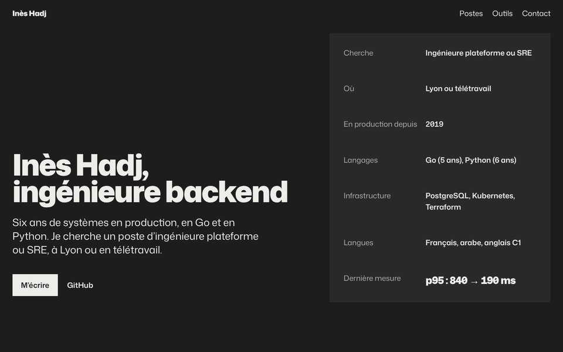

# folio

**Votre CV, devenu un site qui vous ressemble.**

> **Pas envie d'installer quoi que ce soit ?** Envoyez votre CV sur [FOLIO_DOMAIN](https://FOLIO_DOMAIN) et recevez votre site en ligne, dès 12 €. 🇬🇧 [Read in English](README.md)

<p>
  
  
</p>

`folio` est un skill pour agent IA qui transforme un CV en site perso qui n'a pas l'air généré. Donnez-lui un CV (PDF, DOCX, export LinkedIn ou texte) : il construit un site Astro statique avec une direction artistique pensée pour cette personne, le SEO qu'il faut pour sortir en premier sur son nom, et un visuel et un post LinkedIn pour l'annoncer.

Rien n'est inventé : chaque information du site vient du CV.

Les deux sites ci-dessus ont été faits par `folio` à partir de CV fictifs : une infirmière dont la page est une feuille de transmission, une ingénieure dont la page se lit comme une fiche technique. Même skill, rien en commun.

## Vous préférez qu'on s'en occupe ? Passez par FOLIO_DOMAIN

[FOLIO_DOMAIN](https://FOLIO_DOMAIN) lance `folio` pour vous. Envoyez votre CV, recevez votre site en ligne à votre nom. Sans compte, sans abonnement, sans terminal.

| | Skill | Essentiel | Pro |
|---|---|---|---|
| Prix | Gratuit | 12 € une fois | 29 € une fois |
| Site fait à partir de votre CV | ✓ | ✓ | ✓ |
| Hébergement | Par vous | 1 an inclus, sur `prenom-nom.FOLIO_DOMAIN` | 1 an inclus, sur votre propre domaine (.fr compris, .com : +6 €) |
| Modifications | Autant que vous voulez | 2 régénérations | Illimitées pendant 1 an |
| Visuel et post LinkedIn | ✓ | ✓ | ✓ |
| Signature « Fait avec folio » | Au choix | Oui | Non |
| Code source du site | ✓ | | ✓ |
| Renouvellement, après la première année | | 19 € par an | 29 € par an |

Le renouvellement comprend les mises à jour du CV, et rien n'est prélevé automatiquement.

Le skill reste gratuit et open source. Installez-le ci-dessous et lancez-le vous-même quand vous voulez.

## Installation

**Claude Code :**

```bash
/plugin marketplace add lulu38m/folio
/plugin install folio@folio
```

**Codex :**

```bash
codex plugin marketplace add lulu38m/folio
codex plugin add folio@folio
```

**Tout autre agent**, en une commande avec la CLI [`skills`](https://github.com/vercel-labs/skills) (Cursor, Codex, Copilot, Gemini CLI, opencode, etc.) :

```bash
npx skills add https://github.com/lulu38m/folio --skill folio
```

Ajoutez `-g` pour l'installer partout ; sans, il ne vaut que pour le projet en cours.

<details>
<summary>Pas d'installeur ? Copiez le skill à la main.</summary>

```bash
git clone https://github.com/lulu38m/folio
mkdir -p ~/.claude/skills && cp -R folio/skills/folio ~/.claude/skills/
```

Redémarrez Claude Code après la copie. Dans l'app Claude, compressez `skills/folio/` en zip et importez-le dans Paramètres → Capacités → Skills.
</details>

Le dépôt expose aussi le skill aux emplacements standard de chaque agent (`.claude/`, `.agents/`, `.opencode/`), voir le [README en anglais](README.md#also-works-with).

## Utilisation

Joignez votre CV et demandez :

```text
Transforme mon CV en site.
```

Ou partez d'un site existant :

```text
Rends mon site perso moins « fait par une IA ».
```

Le skill fonctionne en français et en anglais, et écrit le site dans la langue du CV. Vous obtenez un dossier avec `work/` (le profil extrait et les notes), `site/` (le code Astro) et `site/dist/`, prêt à mettre en ligne sur Netlify, Vercel, Cloudflare Pages ou GitHub Pages.

## Comment ça marche

1. **Lire.** `extract_cv.py` récupère le texte, les liens et la photo du CV. L'agent remplit un profil en recopiant les faits tels quels, et pose en une seule fois les questions sur ce qui manque.
2. **Masquer le privé.** Téléphone, adresse, date de naissance, nationalité et photo restent hors du site, sauf demande de la personne.
3. **Tirer une direction.** `deal.py` tire trois directions artistiques sur dix, chacune avec sa typographie et sa palette, à partir de la personne : deux personnes du même métier n'ont jamais le même site.
4. **Construire.** Un site Astro statique à partir de `assets/site-template/` : îlots React pour l'animation, Tailwind, polices auto-hébergées (Fontsource), composants [Cult UI](https://www.cult-ui.com) et [Kokonut UI](https://kokonutui.com) en option.
5. **SEO.** `seo_head.py` écrit le titre, la description, l'Open Graph, un `Person` schema.org avec les seules infos publiques, et le sitemap.
6. **Vérifier, regarder, corriger.** `check_site.mjs` ouvre le site dans un vrai navigateur à trois largeurs et refuse ce qui a l'air généré. L'agent regarde les captures, les critique comme un jury, corrige et regarde à nouveau.
7. **Annoncer.** Un visuel et un post LinkedIn pour partager le site.

## Ce qu'il refuse de faire

Barres de compétences, « Salut, moi c'est Alex 👋 », effets machine à écrire, frises à points, avatars ronds, rangées d'icônes, murs de logos, une carte par poste, dégradés, verre dépoli, halos, sur-titres, les palettes crème-terracotta et violettes, les liens Google Fonts, et tout fait absent du CV. Ce sont des règles de style par défaut : un site peut en enfreindre une seule, exprès, si elle cache quelque chose de vrai sur la personne. La police monospace et les filets fins ne donnent plus qu'un avertissement. L'honnêteté, la vie privée et la lisibilité n'ont aucune exception.

## Prérequis

- Un agent compatible Agent Skills : Claude Code, l'app Claude, Codex CLI, opencode, ou tout agent à instructions personnalisées
- Python 3.9+ avec `pypdf`
- Node.js 22.23+ (Node 24 LTS conseillé) et npm. Vérifiez avec `node -v`. Avec une version plus ancienne, le skill récupère Node 24 tout seul avec `npx` ; pour mettre à jour, `nvm install 24` ou nodejs.org
- Playwright avec Chromium, pour la vérification : `npm i -D playwright && npx playwright install chromium`
- Facultatif : `tesseract` (avec le français), pour lire les CV exportés en image (Canva, scans). Sans lui, l'agent lit lui-même l’image de la page

## Crédits et licence

Les crédits complets sont dans le [README en anglais](README.md#credits). Licence [MIT](LICENSE). Le service hébergé sur [FOLIO_DOMAIN](https://FOLIO_DOMAIN) est un produit distinct, construit sur ce skill.
